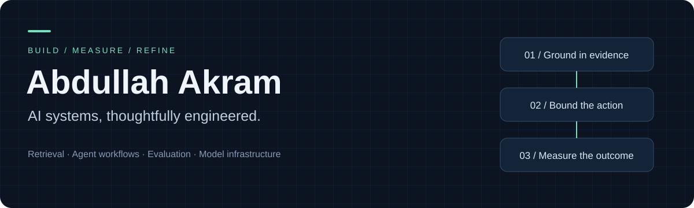
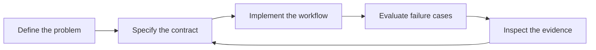

  <b>Applied AI · Python · Reliable systems</b> 
  Building software that makes its evidence, decisions, and failure modes visible.

---

### About my work

I'm Abdullah. My current focus is the engineering around AI: getting useful context into a model, controlling what an agent can do, measuring response quality, and keeping inference costs predictable.

I prefer explicit contracts, inspectable behavior, and small components with clear responsibilities.

### On the workbench

Five projects are being developed locally. Their GitHub repositories are reserved; implementation and walkthroughs will be published after review.

<table>
<tr>
<td width="50%" valign="top">
<h3>01 / Grounded knowledge</h3>

<b>Grounded RAG Assistant</b>

Document ingestion, persistent retrieval, source attribution, and evidence validation.

<a href="https://github.com/abdullahakram07/grounded-rag-assistant">Repository →</a>
</td>
<td width="50%" valign="top">
<h3>02 / Controlled automation</h3>

<b>Bounded Agent Runtime</b>

Durable workflows, explicit approval barriers, resumable execution, and audit trails.

<a href="https://github.com/abdullahakram07/bounded-agent-runtime">Repository →</a>
</td>
</tr>
<tr>
<td width="50%" valign="top">
<h3>03 / Measurable quality</h3>

<b>LLM Evaluation Lab</b>

Versioned cases, baseline comparisons, regression gates, and inspectable reports.

<a href="https://github.com/abdullahakram07/llm-evaluation-lab">Repository →</a>
</td>
<td width="50%" valign="top">
<h3>04 / Inference infrastructure</h3>

<b>AI Model Gateway</b>

Provider routing, spend reservations, request idempotency, and failure handling.

<a href="https://github.com/abdullahakram07/ai-model-gateway">Repository →</a>
</td>
</tr>
<tr>
<td colspan="2" valign="top">
<h3>05 / Trust boundaries</h3>

<b>Prompt Injection Defense Lab</b>

A tool-authorization broker with tenant checks, resource policy, expiring approvals, and adversarial scenarios.

<a href="https://github.com/abdullahakram07/prompt-injection-defense-lab">Repository →</a>
</td>
</tr>
</table>

### How I approach a system

| Principle | What it means in code |
| :--- | :--- |
| Evidence first | Trace responses to their sources and make uncertainty explicit. |
| Bounded actions | Validate tool inputs, permissions, and approval requirements. |
| Observable failures | Preserve useful errors, state transitions, and audit records. |
| Measured quality | Compare behavior against explicit cases and baselines. |

### Current toolkit

**Python** · **SQLite / FTS5** · **HTTP APIs** · **Ollama integrations** · **GitHub Actions** · **Automated testing**

---

Clear inputs. Deliberate decisions. Inspectable results.

