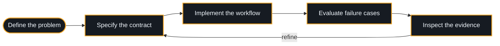

**Building software that makes its evidence, decisions, and failure modes visible.**

[**About**](#about-my-work) &nbsp;·&nbsp; [**Workbench**](#on-the-workbench) &nbsp;·&nbsp; [**Approach**](#how-i-approach-a-system) &nbsp;·&nbsp; [**Toolkit**](#current-toolkit)

---

## About my work

I'm Abdullah. My current focus is the engineering around AI: getting useful context into a model, controlling what an agent can do, measuring response quality, and keeping inference costs predictable.

I prefer explicit contracts, inspectable behavior, and small components with clear responsibilities.

## On the workbench

> [!NOTE]
> Five projects are being developed locally. Their GitHub repositories are reserved; implementation and walkthroughs will be published after review.

| | Project | Concern | Repository |
| :-: | :-- | :-- | :-: |
| 🔎 | **Grounded RAG Assistant** | Grounded knowledge | [Open →](https://github.com/abdullahakram07/grounded-rag-assistant) |
| 🛡️ | **Bounded Agent Runtime** | Controlled automation | [Open →](https://github.com/abdullahakram07/bounded-agent-runtime) |
| 📏 | **LLM Evaluation Lab** | Measurable quality | [Open →](https://github.com/abdullahakram07/llm-evaluation-lab) |
| 🚦 | **AI Model Gateway** | Inference infrastructure | [Open →](https://github.com/abdullahakram07/ai-model-gateway) |
| 🧱 | **Prompt Injection Defense Lab** | Trust boundaries | [Open →](https://github.com/abdullahakram07/prompt-injection-defense-lab) |

<b>🔎 Grounded RAG Assistant</b> &nbsp;·&nbsp; grounded knowledge

 

- Document ingestion
- Persistent retrieval
- Source attribution
- Evidence validation

<b>🛡️ Bounded Agent Runtime</b> &nbsp;·&nbsp; controlled automation

 

- Durable workflows
- Explicit approval barriers
- Resumable execution
- Audit trails

<b>📏 LLM Evaluation Lab</b> &nbsp;·&nbsp; measurable quality

 

- Versioned cases
- Baseline comparisons
- Regression gates
- Inspectable reports

<b>🚦 AI Model Gateway</b> &nbsp;·&nbsp; inference infrastructure

 

- Provider routing
- Spend reservations
- Request idempotency
- Failure handling

<b>🧱 Prompt Injection Defense Lab</b> &nbsp;·&nbsp; trust boundaries

 

A tool-authorization broker with:

- Tenant checks
- Resource policy
- Expiring approvals
- Adversarial scenarios

## How I approach a system

| Principle | What it means in code |
| :-- | :-- |
| **Evidence first** | Trace responses to their sources and make uncertainty explicit. |
| **Bounded actions** | Validate tool inputs, permissions, and approval requirements. |
| **Observable failures** | Preserve useful errors, state transitions, and audit records. |
| **Measured quality** | Compare behavior against explicit cases and baselines. |

## Current toolkit

---

Clear inputs. Deliberate decisions. Inspectable results.

